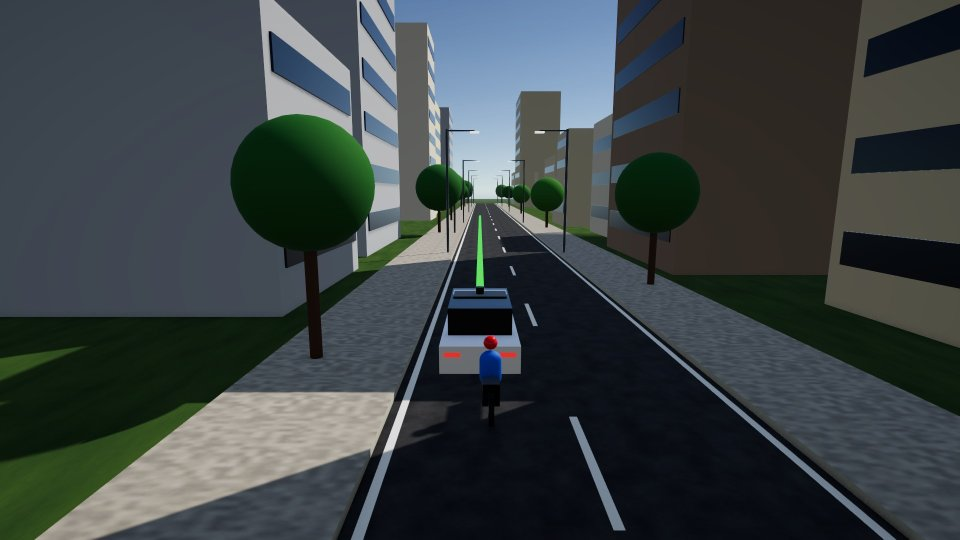
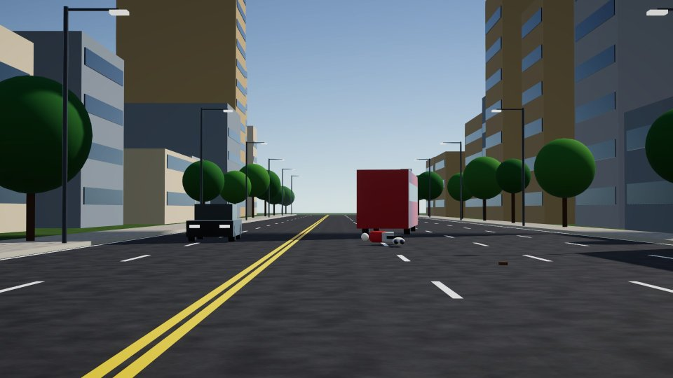
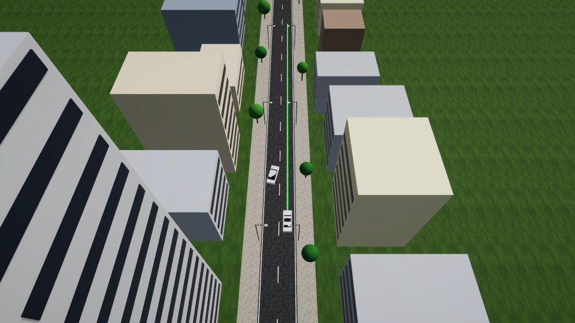

# adastest: Dashcam → Unity, kiểm thử xe tự hành closed-loop

> ⚠️ **v0.1, bản test thử. Còn lỏ lắm.**
> Đây mới là bản chạy được từ đầu tới cuối để kiểm tra ý tưởng. Quang cảnh và xe trong Unity đang là khối hộp low-poly sinh bằng code, sẽ được thiết kế lại. Số liệu, AV stack và pipeline đều còn nhiều lỗi đã biết (xem [`Code/docs/BUG_LOG.md`](Code/docs/BUG_LOG.md)). Đừng dùng để kết luận gì về an toàn.



| Góc dashcam (dựng lại từ video thật) | Nhìn từ trên (kịch bản tạt đầu) |
|---|---|
|  |  |

## Ý tưởng

Lấy video camera hành trình rồi "dịch" thành một kịch bản có cấu trúc gồm đường, các xe với quỹ đạo theo thời gian, và đèn giao thông. Dựng lại kịch bản đó trong Unity, rồi thả **xe tự hành của mình** vào chạy closed-loop: xe tự quyết định, thế giới quanh nó phản ứng lại.

Nguyên tắc là hạn chế VLM/AIGC, dùng model chuyên dụng (detection, tracking, hình học camera) để kết quả chạy lại ra y hệt và debug được.

```
Video dashcam ──▶ Code/pipeline/ ──▶ scenario.json ◀── Code/scenarios/handmade/
                                          │
                       ┌──────────────────┴──────────────────┐
                       ▼                                     ▼
              Code/sim/ (2D, nhanh)                   Unity/ (3D)
                       │                                     │ TCP, mỗi dòng 1 JSON
                       └──────────▶ Code/av_stack/ ◀── Code/bridge/tcp_server.py
```

## Cấu trúc repo

| Thư mục | Nội dung |
|---|---|
| `Code/` | Python: `pipeline/` (video → scenario), `av_stack/`, `sim/` + `eval/` (sim 2D, chấm điểm), `bridge/` (nối Unity), `demo/`, `docs/`, `tests/` |
| `Unity/` | Project Unity 6000.6.8f1 (URP 17.6). Code ở `Assets/Scripts/Adas/` |

## Có gì trong v0.1

| Phần | Trạng thái |
|---|---|
| Pipeline: YOLO26x + ByteTrack, ego-motion, nâng 2D→3D theo mặt đường, Kalman/RTS | Chạy được trên 1 clip ở điều kiện lý tưởng. Khoảng cách xa còn sai nhiều |
| AV stack: đổi làn, sinh đường, pure pursuit, bám khoảng cách, AEB | Dùng ground truth, **chưa biết né**, chỉ phanh |
| Sim 2D + chấm điểm: tất định, các mode M1–M4 | Ổn, nhưng đừng tin score một mình (B20) |
| Bridge Unity ↔ AV Python | Ổn |
| Unity: dựng đường, xe, cảm biến, vật lý RCC | Hình tạm, vật lý RCC không tất định (B37) |

Giải thích đầy đủ ở [`Code/docs/HE_THONG.md`](Code/docs/HE_THONG.md). Kế hoạch tổng thể ở [`Code/PLAN.md`](Code/PLAN.md).

## Chạy phần Python

Cần Python 3.12. Venv đặt ở gốc repo, còn lệnh thì chạy trong `Code/`.

```bash
python -m venv .venv && .venv\Scripts\activate
pip install torch torchvision --index-url https://download.pytorch.org/whl/cu128   # chọn theo GPU
pip install -r Code/requirements.txt
cd Code

# Sim 2D với kịch bản viết tay (không cần GPU, không cần video)
python -m sim.run scenarios/handmade/lead_brake.json --mode M3 --plot

# Test
python -m pytest -q tests
```

Pipeline từ video thì cần tự có video và weight YOLO (không có trong repo):
```bash
python -m pipeline.run --video <video.mp4> --start 29.6 --duration 21 --camera data/calib/clip02_fit.yaml \
    --name clip02 --straight --obstacles --debug-video
```

## Chạy phần Unity

1. **Cài Unity 6000.6.8f1.** Trong Unity Hub chọn *Add project from disk*, rồi trỏ tới thư mục `Unity/`.
2. **Import Realistic Car Controller Pro** (Asset Store, trả phí). Repo **không** chứa package này vì giấy phép không cho đăng công khai. Vào *Window → Package Manager → My Assets* rồi import vào `Assets/Realistic Car Controller Pro/`. Thiếu RCC thì project **không compile được**, vì `ScenarioPlayer` và `RccDriver` dùng kiểu `RCCP_*` của nó.
3. **Chạy bridge**, rồi mở một scene trong `Assets/Scenes/` (ví dụ `Adas_lead_brake.unity`) và bấm Play. Muốn dựng scene mới thì dùng menu **ADAS** trên thanh menu.
   ```bash
   cd Code && python -m bridge.tcp_server --port 5555
   ```
4. **Phím tắt:** `C` đổi camera, `Space` tạm dừng, `R` chạy lại, `H` ẩn HUD, `P` bảng thông số, `M` lái tay, `+`/`-` đổi tốc độ.

Unity đọc kịch bản từ `Unity/Assets/StreamingAssets/*.json`. Hiện file phải copy tay từ `Code/scenarios/`.

### Quay video demo

Không cần Play mode. Nhớ đóng Unity Editor trước khi chạy:
```bash
Unity.exe -batchmode -projectPath Unity -executeMethod Adas.EditorTools.AdasRecord.All -quit -logFile Logs/record.log
cd Code && python -m demo.encode_frames ../Unity/Logs/rec --out "../demo videos/unity"
```

## Không có trong repo

- Video dashcam gốc. Bản quyền thuộc kênh gốc, file lại nặng 1 GB.
- Weight YOLO (`*.pt`). Tải qua `ultralytics`.
- Realistic Car Controller Pro (asset trả phí).
- Tài liệu PDF tham khảo.
- Kết quả trung gian: `work/`, `runs/`. Chạy lại là có.

## Sắp tới

- Thiết kế lại quang cảnh: đường phố Việt Nam, nhà, cây, vạch kẻ.
- Model xe thật cho từng class: ô tô, xe máy, xe buýt, xe tải, người.
- AV biết né thay vì chỉ phanh. Đưa camera/LiDAR trong sim vào AV thay cho ground truth.
- Agent phản ứng (M3) và `events` (M4) bên Unity.
- Chạy nhiều clip hơn, kiểm khoảng cách bằng LiDAR.
